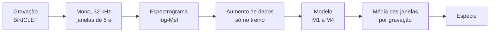

# birdclef-dl
Classificação de aves pelo canto (BirdCLEF, Kaggle) — projeto de Deep Learning, UFPE 2026.2

Projeto da disciplina CIN0040 Introdução à Aprendizagem Profunda (Prof. Tsang Ing Ren).
A proposta completa está em [proposta/main.pdf](proposta/main.pdf) (fonte em `proposta/main.tex`).
Este README resume o plano; em caso de divergência, vale a proposta.

## Objetivo

Identificar a espécie de uma ave a partir de trechos de 5 s do canto, comparando uma CNN e uma
CRNN treinadas do zero com modelos de áudio pré-treinados no AudioSet, e medindo o efeito do
aumento de dados na robustez a ruído.

**Hipóteses**

- **H1:** os pré-treinados (M3, M4) superam os treinados do zero (M1, M2) em F1-macro,
  sobretudo nas espécies com poucas gravações.
- **H2:** a CRNN (M2) supera a CNN (M1) de mesmo porte.
- **H3:** o aumento de dados reduz a queda de desempenho sob ruído (SNR ≤ 10 dB).

## Pipeline



| Etapa | Configuração |
|---|---|
| Subconjunto | 15 a 20 espécies com mais gravações, até ~150 gravações por espécie, priorizando qualidade |
| Janelas | 5 s, sobreposição de 50% no treino; janelas de energia muito baixa descartadas (rótulo fraco) |
| log-Mel (M1, M2) | 32 kHz, 128 bandas, 50 Hz a 14 kHz |
| log-Mel (M3, PANNs) | 32 kHz, 64 bandas (configuração original do PANNs) |
| log-Mel (M4, AST) | 16 kHz, 128 bandas (configuração original do AST) |
| Inferência | média das probabilidades das janelas de cada gravação |

## Modelos

| ID | Arquitetura | Inicialização |
|---|---|---|
| M1 | CNN, 4 blocos Conv-BN-ReLU-Pool + pooling global | aleatória |
| M2 | CRNN: blocos convolucionais + GRU bidirecional no eixo do tempo | aleatória |
| M3 | PANNs CNN14 | AudioSet |
| M4 | Audio Spectrogram Transformer (opcional, se o orçamento de GPU permitir) | AudioSet |

Todos: softmax sobre as espécies, entropia cruzada, AdamW, parada antecipada pelo F1-macro de
validação.

**Aumento de dados:** SpecAugment (máscaras de tempo e frequência), mixup e mistura de ruído de
fundo da ESC-50 (chuva, vento, insetos).

## Protocolo experimental

Toda divisão é **agrupada por gravação**: janelas da mesma gravação nunca ficam em partições
diferentes. Teste fixo com 20% das gravações (estratificado por espécie), usado só na avaliação
final; nos 80% restantes, validação cruzada estratificada e agrupada com k = 5.

| Experimento | O que mede | Hipótese |
|---|---|---|
| E1 Arquiteturas | M1 a M4, mesma configuração de aumento, 5 folds | H1, H2 |
| E2 Ablação de aumento | sem aumento, cada técnica e todas, no melhor do zero e no melhor pré-treinado; 1 fold, 3 sementes | |
| E3 Robustez a ruído | teste corrompido com ESC-50 em SNR de 20, 10, 5 e 0 dB, com e sem aumento | H3 |
| E4 Eficiência de dados | treino com 25%, 50% e 100% das gravações, do zero contra pré-treinado | H1 |

**Métricas:** F1-macro (principal), acurácia top-1 e top-3, mAP, matriz de confusão; média ±
desvio entre folds ou sementes. Análise qualitativa com Grad-CAM nos espectrogramas e t-SNE dos
embeddings.

## Estrutura do repositório

```
birdclef-dl/
  proposta/        # proposta em LaTeX (IEEE) e PDF
  src/birdclef/    # código compartilhado: pré-processamento, modelos, treino, avaliação
  notebooks/       # notebooks do Colab (EDA, treino de cada modelo, análises)
  resultados/      # tabelas e figuras pequenas que vão para o relatório
  dados/           # fora do git; layout em dados/README.md
  checkpoints/     # fora do git; pesos treinados e pré-treinados baixados
```

O código fica em `src/birdclef/` e os notebooks só o importam, para que os quatro modelos usem
exatamente o mesmo pré-processamento, as mesmas divisões e as mesmas métricas.

## Como rodar (Colab)

```python
from google.colab import drive
drive.mount('/content/drive')

!git clone https://github.com/arbcaio/birdclef-dl.git
%cd birdclef-dl
!pip install -q -r requirements.txt
!pip install -q -e .
!ln -s /content/drive/MyDrive/birdclef-dl/dados dados
!ln -s /content/drive/MyDrive/birdclef-dl/checkpoints checkpoints
```

Os dados e os espectrogramas pré-computados ficam numa pasta compartilhada do Drive com o mesmo
layout de `dados/`. Para baixar o BirdCLEF, cada um aceita as regras da competição no Kaggle e usa
o próprio `kaggle.json` (nunca versionado). Treinar com precisão mista e salvar checkpoints no
Drive, por causa dos limites de sessão do Colab.

**Nada de dados, áudio, espectrogramas ou pesos no git:** o repositório é público e as regras do
Kaggle não permitem redistribuir os dados. O `.gitignore` já bloqueia esses arquivos.

## Divisão de tarefas

| Quem | Responsável por |
|---|---|
| Kaique | M1 e M2 (modelos treinados do zero) |
| Giovanny | M3 e M4 (modelos pré-treinados) |
| Caio | dados, aumento de dados e experimentos de robustez (E2, E3) |
| Todos | análise dos resultados, relatório e apresentação |

## Cronograma

| Semana | Período | Atividades |
|---|---|---|
| S1 | 14 a 20/10 | proposta, revisão bibliográfica, coleta dos dados e EDA |
| S2 | 21 a 27/10 | EDA, pipeline de pré-processamento, M1 e M2 (E1) |
| S3 | 28/10 a 03/11 | M1 e M2 (E1), fine-tuning de M3 e M4 (E1) |
| S4 | 04 a 10/11 | fine-tuning de M3 e M4, ablação e robustez (E2, E3) |
| S5 | 11 a 17/11 | E2, E3, eficiência de dados (E4), análises, relatório |
| S6 | 18 a 25/11 | relatório IEEE, slides, entrega final |

Datas da disciplina: entrega da proposta em 03/11; apresentações em 01 e 03/12; entrega dos
projetos em 10/12.

## Pendências

- [ ] Escolher a edição do BirdCLEF (as espécies e a região mudam a cada ano).
- [ ] Confirmar a data da entrega final: a proposta diz 25/11, o calendário da disciplina diz 10/12.
- [ ] Convidar Kaique e Giovanny como colaboradores do repositório.
- [ ] Criar a pasta compartilhada no Drive com o layout de `dados/`.
- [ ] Decidir como carregar o PANNs CNN14 (código oficial ou pacote) e os pesos do AST.
