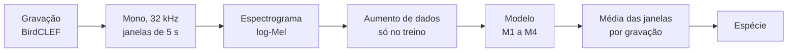
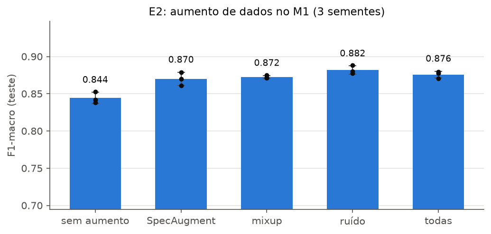
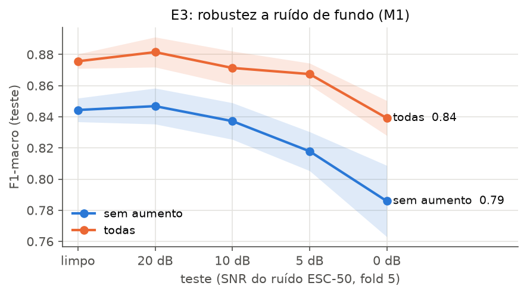

# birdclef-dl
Classificação de aves pelo canto (BirdCLEF, Kaggle) — projeto de Deep Learning, UFPE 2026.2

Projeto da disciplina CIN0040 Introdução à Aprendizagem Profunda (Prof. Tsang Ing Ren).
A proposta completa está em [proposta/main.pdf](proposta/main.pdf) (fonte em `proposta/main.tex`).
Este README resume o plano; em caso de divergência, vale a proposta.

## Objetivo

Identificar a espécie de uma ave a partir de trechos de 5 s do canto, comparando uma CNN e uma
CRNN treinadas do zero com modelos de áudio pré-treinados no AudioSet, e medindo o efeito do
aumento de dados na robustez a ruído.

**Hipóteses**

- **H1:** os pré-treinados (M3, M4) superam os treinados do zero (M1, M2) em F1-macro,
  sobretudo nas espécies com poucas gravações.
- **H2:** a CRNN (M2) supera a CNN (M1) de mesmo porte.
- **H3:** o aumento de dados reduz a queda de desempenho sob ruído (SNR ≤ 10 dB).

## Pipeline



| Etapa | Configuração |
|---|---|
| Subconjunto | 15 a 20 espécies com mais gravações, até ~150 gravações por espécie, priorizando qualidade |
| Janelas | 5 s, sobreposição de 50% no treino; janelas de energia muito baixa descartadas (rótulo fraco) |
| log-Mel (M1, M2) | 32 kHz, 128 bandas, 50 Hz a 14 kHz |
| log-Mel (M3, PANNs) | 32 kHz, 64 bandas (configuração original do PANNs) |
| log-Mel (M4, AST) | 16 kHz, 128 bandas (configuração original do AST) |
| Inferência | média das probabilidades das janelas de cada gravação |

## Modelos

| ID | Arquitetura | Inicialização |
|---|---|---|
| M1 | CNN, 4 blocos Conv-BN-ReLU-Pool + pooling global | aleatória |
| M2 | CRNN: blocos convolucionais + GRU bidirecional no eixo do tempo | aleatória |
| M3 | PANNs CNN14 | AudioSet |
| M4 | Audio Spectrogram Transformer (opcional, se o orçamento de GPU permitir) | AudioSet |

Todos: softmax sobre as espécies, entropia cruzada, AdamW, parada antecipada pelo F1-macro de
validação.

**Aumento de dados:** SpecAugment (máscaras de tempo e frequência), mixup e mistura de ruído de
fundo da ESC-50 (chuva, vento, insetos).

## Protocolo experimental

Toda divisão é **agrupada por gravação**: janelas da mesma gravação nunca ficam em partições
diferentes. Teste fixo com 20% das gravações (estratificado por espécie), usado só na avaliação
final; nos 80% restantes, validação cruzada estratificada e agrupada com k = 5.

| Experimento | O que mede | Hipótese |
|---|---|---|
| E1 Arquiteturas | M1 a M4, mesma configuração de aumento, 5 folds | H1, H2 |
| E2 Ablação de aumento | sem aumento, cada técnica e todas, no melhor do zero e no melhor pré-treinado; 1 fold, 3 sementes | |
| E3 Robustez a ruído | teste corrompido com ESC-50 em SNR de 20, 10, 5 e 0 dB, com e sem aumento | H3 |
| E4 Eficiência de dados | treino com 25%, 50% e 100% das gravações, do zero contra pré-treinado | H1 |

**Métricas:** F1-macro (principal), acurácia top-1 e top-3, mAP, matriz de confusão; média ±
desvio entre folds ou sementes. Análise qualitativa com Grad-CAM nos espectrogramas e t-SNE dos
embeddings.

## Parte 1: dados, pipeline e M1

Implementada em `src/birdclef/` e nos notebooks `01` a `03`.

| Etapa | Onde | O que foi feito |
|---|---|---|
| Subconjunto | `dados.py`, `01_eda` | 20 espécies de aves com mais gravações do xeno-canto com nota ≥ 4; 150 gravações por espécie (3000 no total) |
| Divisões | `dados.py`, `01_eda` | teste fixo de 20% (600 gravações) estratificado; 5 folds estratificados nos 80% restantes; semente 42; janelas herdam a partição da gravação |
| log-Mel | `preproc.py`, `02_preprocessamento` | até 12 janelas de 5 s por gravação (passo 2,5 s), descarte de janelas 20 dB abaixo da mais forte; 128 × 313 em dB (ref. fixa), float16; 23 635 janelas |
| Aumento | `aumento.py` | SpecAugment (2 máscaras de freq. ≤ 16 bandas, 2 de tempo ≤ 40 quadros), mixup (α = 0,4), ruído ESC-50 folds 1-4 (p = 0,5, SNR 0-20 dB, somado em potência) |
| Teste ruidoso | `aumento.py` | teste refeito com ruído ESC-50 fold 5 (nunca visto no treino), misturado na forma de onda a 20, 10, 5 e 0 dB |
| Treino | `treino.py` | sorteio com peso 1/(janelas da gravação), AdamW (lr 1e-3), cosseno, precisão mista, até 30 épocas, parada antecipada (paciência 6) pelo F1-macro de validação por gravação |
| M1 | `modelos.py` | 4 blocos Conv3×3-BN-ReLU-MaxPool (32-64-128-256), média na frequência, média + máximo no tempo, dropout 0,3; 393 mil parâmetros |
| E2, E3 | `experimentos.py`, `graficos.py`, `03_m1_experimentos` | ver Resultados |

Para rodar localmente: `python -m birdclef.experimentos [e2|e3|tudo]` e `python -m birdclef.graficos`.

### Resultados (M1, fold 0 de validação, 3 sementes, média ± desvio)

Rodado numa RTX 3050 Laptop (4 GB): ~10 min por treino, 17-20 s por época.

**E2: aumento de dados** (`resultados/e2/`)

| Aumento | F1-macro val. | F1-macro teste | Top-1 teste | Top-3 teste | mAP teste |
|---|---|---|---|---|---|
| sem | 0,825 ± 0,011 | 0,844 ± 0,008 | 0,843 ± 0,009 | 0,944 ± 0,011 | 0,903 ± 0,003 |
| SpecAugment | 0,846 ± 0,012 | 0,870 ± 0,009 | 0,870 ± 0,008 | 0,953 ± 0,003 | 0,921 ± 0,004 |
| mixup | 0,836 ± 0,005 | 0,872 ± 0,002 | 0,872 ± 0,001 | 0,951 ± 0,005 | 0,923 ± 0,003 |
| ruído | 0,858 ± 0,004 | **0,882 ± 0,006** | **0,881 ± 0,005** | **0,963 ± 0,003** | 0,928 ± 0,005 |
| todas | 0,857 ± 0,001 | 0,876 ± 0,005 | 0,874 ± 0,004 | 0,959 ± 0,005 | **0,932 ± 0,007** |

Cada técnica sozinha melhora o M1 em 2,6 a 3,8 pontos de F1-macro no teste; o ruído de fundo é a
melhor isolada, e combinar as três não soma os ganhos (fica entre as isoladas, com o maior mAP).
Com aumento, a maioria dos treinos ainda melhorava na época 30, então há espaço para treinar mais.

**E3: robustez a ruído** (`resultados/e3/`): F1-macro no teste com ruído da ESC-50 (fold 5)

| Aumento | limpo | 20 dB | 10 dB | 5 dB | 0 dB | queda limpo → 0 dB |
|---|---|---|---|---|---|---|
| sem | 0,844 | 0,847 | 0,837 | 0,818 | 0,786 | −5,8 pontos |
| todas | 0,876 | 0,881 | 0,871 | 0,867 | 0,839 | −3,7 pontos |

O aumento reduz a queda sob ruído forte (SNR ≤ 5 dB), a favor de H3: a 5 dB o modelo com aumento
perde 0,9 ponto e o sem aumento perde 2,6. A 0 dB o modelo com aumento ainda fica no nível do sem
aumento no teste limpo.




## Estrutura do repositório

```
birdclef-dl/
  proposta/        # proposta em LaTeX (IEEE) e PDF
  src/birdclef/    # código compartilhado: pré-processamento, modelos, treino, avaliação
  notebooks/       # notebooks do Colab (EDA, treino de cada modelo, análises)
  resultados/      # tabelas e figuras pequenas que vão para o relatório
  dados/           # fora do git; layout em dados/README.md
  checkpoints/     # fora do git; pesos treinados e pré-treinados baixados
```

O código fica em `src/birdclef/` e os notebooks só o importam, para que os quatro modelos usem
exatamente o mesmo pré-processamento, as mesmas divisões e as mesmas métricas.

## Como rodar (Colab)

```python
from google.colab import drive
drive.mount('/content/drive')

!git clone https://github.com/arbcaio/birdclef-dl.git
%cd birdclef-dl
!pip install -q -r requirements.txt
!pip install -q -e .
!ln -s /content/drive/MyDrive/birdclef-dl/dados dados
!ln -s /content/drive/MyDrive/birdclef-dl/checkpoints checkpoints
```

Os dados e os espectrogramas pré-computados ficam numa pasta compartilhada do Drive com o mesmo
layout de `dados/`. Para baixar o BirdCLEF, cada um aceita as regras da competição no Kaggle e usa
o próprio `kaggle.json` (nunca versionado). Treinar com precisão mista e salvar checkpoints no
Drive, por causa dos limites de sessão do Colab.

**Nada de dados, áudio ou espectrogramas no git:** o repositório é público e as regras do
Kaggle não permitem redistribuir os dados. O `.gitignore` já bloqueia esses arquivos.

> **Atenção: estes arquivos não estão no repositório e precisam ser gerados (ou copiados do Drive
> compartilhado) antes de treinar:**
>
> | Arquivo | Por que fica fora | Como obter |
> |---|---|---|
> | `dados/bruto/` (BirdCLEF 2025) | regras da competição | aceitar as regras no Kaggle e baixar com o próprio `kaggle.json` |
> | `dados/ruido/` (ESC-50) | áudio | baixar a ESC-50 (CC BY-NC) e extrair os folds usados |
> | `dados/subconjunto/divisoes.csv` | nomes de arquivo do BirdCLEF | `notebooks/01_eda.ipynb` (determinístico, semente 42) |
> | `dados/espectrogramas/mel128_32k/` (`X*.npy`, `R.npy`, `janelas*.csv`), ~3,3 GB | derivados dos áudios | `notebooks/02_preprocessamento.ipynb` (~10 min numa GPU de notebook) |
>
> Estão no git, por serem leves e não redistribuírem os dados: os pesos do M1 (`checkpoints/M1_*.pt`)
> e as predições no teste (`resultados/e2/*.npy`). Quem tiver acesso aos dados nunca deve
> compartilhá-los com quem não aceitou as regras do BirdCLEF.

## Divisão de tarefas

O grupo ficou com duas pessoas (o professor pede grupos de 2). O trabalho se divide em duas
partes; a Parte 1 vem primeiro porque as outras dependem dos dados e do pipeline.

| Parte | Quem | Responsável por |
|---|---|---|
| 1. Dados e pipeline | Caio | EDA e escolha do subconjunto; divisões agrupadas por gravação; pré-processamento log-Mel; aumento de dados; M1 (CNN do zero, que também valida o pipeline); E2 e E3 |
| 2. Modelos | Giovanny Lira | M2 (CRNN); M3 (PANNs CNN14); M4 (AST, só se sobrar tempo e GPU); E1 e E4 |
| Juntos | os dois | análise dos resultados, relatório IEEE e slides |

## Cronograma

| Semana | Período | Atividades |
|---|---|---|
| S1 | 14 a 20/10 | proposta, revisão bibliográfica, coleta dos dados e EDA |
| S2 | 21 a 27/10 | EDA, pipeline de pré-processamento, M1 e M2 (E1) |
| S3 | 28/10 a 03/11 | M1 e M2 (E1), fine-tuning de M3 e M4 (E1) |
| S4 | 04 a 10/11 | fine-tuning de M3 e M4, ablação e robustez (E2, E3) |
| S5 | 11 a 17/11 | E2, E3, eficiência de dados (E4), análises, relatório |
| S6 | 18 a 25/11 | relatório IEEE, slides, entrega final |

Entrega final (slides, códigos e relatório): **25/11/2026**, conforme os slides de projetos do
professor. Código em Python no Colab, com as bibliotecas usadas declaradas. Nota: 40%
apresentação, 60% relatório e código.

## Pendências

- [x] Edição do BirdCLEF: **2025** (Colômbia), filtrando só as aves. Em `dados/bruto/` ficam os
  CSVs e o `train_audio/`; o `train_soundscapes/` (sem rótulo) não é usado.
- [x] Data da entrega final: 25/11 (slides de projetos do professor).
- [x] Parte 1: subconjunto, divisões, log-Mel, aumento, M1, E2 e E3 (resultados acima).
- [ ] Parte 2: M2, M3, (M4), E1 e E4, reaproveitando `preproc`, `aumento`, `treino` e as mesmas
  divisões. O E1 do M1 é `treino.treinar` com `fold_val` de 0 a 4 e `aumento.CONFIGS_E2["todas"]`.
- [ ] Convidar o Giovanny Lira como colaborador do repositório.
- [ ] Criar a pasta compartilhada no Drive com o layout de `dados/`.
- [ ] Decidir como carregar o PANNs CNN14 (código oficial ou pacote) e os pesos do AST.
